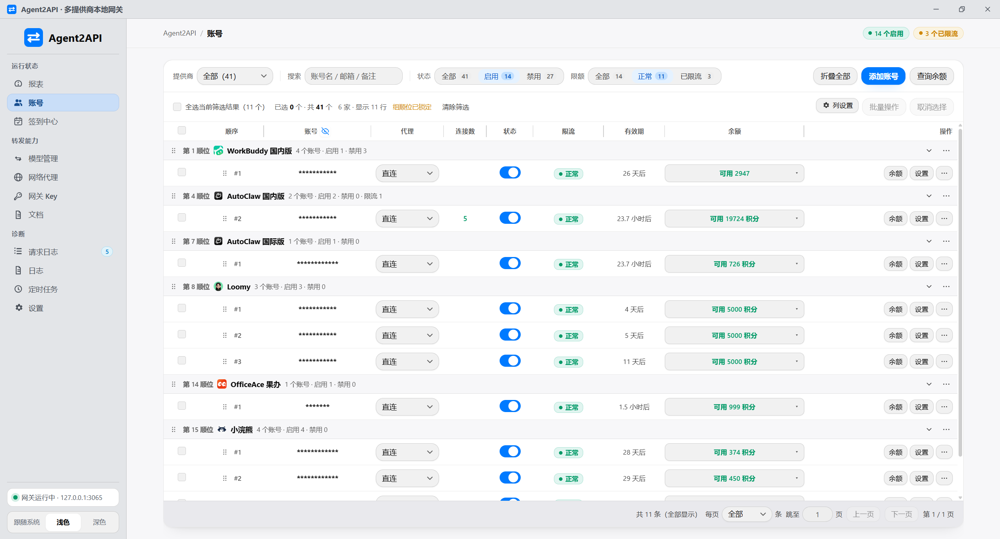
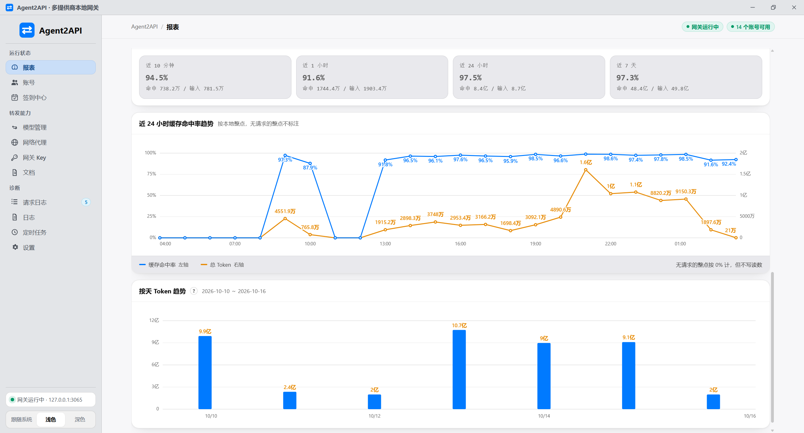

<div align="center">

# Agent2API

**把多家 AI 桌面客户端的登录态，变成一个本地 OpenAI 兼容 API 网关**

[简体中文](./README.md) | [English](./docs/README.en.md) | [繁體中文](./docs/README.zh-Hant.md) | [日本語](./docs/README.ja.md) | [한국어](./docs/README.ko.md) | [Português (BR)](./docs/README.pt-BR.md)

[](./LICENSE)
[](https://github.com/Agent2API/agent2api/releases/latest)
[](https://hub.docker.com/r/aimodcc/agent2api)
[](https://github.com/Agent2API/agent2api/stargazers)
[](https://github.com/Agent2API/agent2api/releases/latest)

[✨ 核心特性](#-核心特性) • [💬 社区与支持](#-社区与支持) • [🤝 支持的提供商](#-支持的提供商) • [🚀 快速开始](#-快速开始) • [📦 安装与部署](./docs/install.md) • [📸 界面预览](#-界面预览) • [🔧 开发与构建](#-开发与构建) • [📜 使用声明](#-使用声明)

</div>

---

Agent2API 把多家 AI 桌面客户端里已登录的账号接到一起，共用一套 OpenAI 兼容接口。任何支持自定义 `base_url` 的客户端，填上 `http://127.0.0.1:3065/v1` 就能直接调用这些账号的模型额度 —— **不需要上游 API Key，也不需要改客户端**。

## ✨ 核心特性

- 🔌 **OpenAI 兼容** —— 客户端填个 `base_url` 就能用，Chat / Responses / Messages 三种协议都支持
- 🏪 **内置 17 家提供商** —— WorkBuddy、小浣熊、CatPaw、Qoder、Trae 等开箱即用，也支持自定义提供商
- 🔁 **凭证自动续期** —— Token 到期自动换新，临期凭证可批量刷新，模型目录也不会过期
- 🪂 **多账号轮转** —— 按优先级排队，429 自动换账号，限额冷却期内不空等
- 🛡️ **出网代理** —— 每个账号可配独立出口，出站指纹按官方客户端伪装
- 🔑 **网关安全** —— 多把网关 Key 可分权、登录有人机验证，没配 Key 时默认拒绝请求
- 📊 **请求报表** —— 请求量、成功率、Token 消耗一览，还有缓存命中率与 365 天热力图
- ⏰ **定时任务** —— 自动签到、凭证维护、模型目录刷新，开关与间隔在一页里管理
- 💰 **余额与用量** —— 账号行内直接看余额与用量，支持跨账号并发查询
- 🖥️ **三种形态** —— 桌面端（Windows / macOS / Linux，托盘常驻）、服务端（Windows / Linux，无界面，注册成系统服务）、Docker（面板与网关同端口，amd64 / arm64）；都不需要装 Node，界面六语

## ❤️ 赞助商

<a href="https://proxylane.dev/zh-cn/isp-proxies?utm_source=agent2api&utm_medium=partnership&utm_campaign=agent2api_202610&utm_content=github_readme"></a>

<table>

<tr>
<td width="240"><a href="https://proxylane.dev/zh-cn/isp-proxies?utm_source=agent2api&utm_medium=partnership&utm_campaign=agent2api_202610&utm_content=github_readme"><picture><source media="(prefers-color-scheme: dark)" srcset="assets/proxylane-logo-for-dark-bg.png" /></picture></a></td>
<td>感谢 <a href="https://proxylane.dev/zh-cn/isp-proxies?utm_source=agent2api&utm_medium=partnership&utm_campaign=agent2api_202610&utm_content=github_readme">ProxyLane</a> 赞助了本项目！ProxyLane 提供 AI 账号专用的原生静态住宅 IP（Static Residential ISP）：IP 来自真实家庭宽带运营商，Scamalytics 低欺诈评分，每个 IP 独享，不限流量，$3.90 起。在「网络代理」页给每个账号配一个出口即可。首次购买使用优惠码 <code>AGENT2API25</code> 享 75 折。</td>
</tr>

</table>

## 💬 社区与支持

- **QQ 群**：Agent2API 交流群 —— **群 1（`1127656296`）即将满员，请优先加群 2（`1130894674`）**；在 QQ 里搜索群号即可加入。
- **Telegram 群**：<https://t.me/+9gM8YPvgRL02NGRl>
- **Discord 群**：<https://discord.gg/z9GzSJMWp>
- **💖 赞赏**：如果 Agent2API 帮到了你，欢迎[请作者喝杯咖啡](docs/SPONSOR.md)；赞赏完全自愿，不解锁任何功能。
- **🤝 赞助 / 商务合作**：想赞助本项目，或想让你的产品出现在这里？发邮件到 [541675139@qq.com](mailto:541675139@qq.com)。

## 🤝 支持的提供商

支持情况一览（✓ 支持 · ✗ 不支持 · — 无此概念）：

| 平台 | LLM 请求 | Token 自动续期 | 模型列表 | 余额查询 | 签到 | 领取类 |
| --- | :--: | :--: | :--: | :--: | :--: | :--: |
| WorkBuddy 国内版 | ✓ | ✓ | ✓ | ✓ | ✓ | ✓ |
| WorkBuddy 国际版 | ✓ | ✓ | ✓ | ✓ | ✗ | — |
| 小浣熊 | ✓ | ✓ | ✓ | ✓ | ✓ | — |
| CatPaw | ✓ | ✗ | ✓ | ✓ | ✗ | — |
| AutoClaw（国内版 / 国际版） | ✓ | ✓ | ✓ | ✓ | ✓ | — |
| Qoder | ✓ | ✓ | ✓ | ✓ | ✓ | — |
| Cline（Free / Pass） | ✓ | ✓ | ✓ | ✓ | — | — |
| Accio（国际版 / 国内版） | ✓ | ✓ | ✓ | ✓ | — | — |
| ZCode（国内版 / 国际版） | ✓ | ✗ | ✗ | ✓ | — | ✓ |
| CodeArts | ✓ | ✓ | ✓ | ✓ | — | ✓ |
| Trae | ✓ | ✓ | ✓ | ✓ | — | — |
| Loomy（讯飞） | ✓ | ✗ | ✓ | ✓ | ✓ | — |
| KukuAI（百度文库） | ✓ | ✗ | ✓ | ✓ | ✓ | — |
| MonkeyCode（长亭科技，国内版 / 国际版） | ✓ | ✗ | ✓ | — | — | — |
| Command Code | ✓ | ✗ | ✓ | — | — | — |
| Antigravity（Google，Gemini / Claude / GPT-OSS） | ✓ | ✓ | ✓ | — | — | — |
| OfficeAce（华为云果办 / OfficeClaw） | ✓ | ✓ | ✓ | ✓ | ✓ | — |
| OrcaTerm（腾讯云遨驰终端） | ✓ | ✓ | ✓ | ✓ | — | — |
| 智谱清言 | ✓ | ✓ | ✓ | ✓ | ✓ | ✓ |
| 自定义提供商 | ✓ | — | ✓ | — | — | — |
| OpenCode2API（可选 sidecar） | ✓ | — | ✓ | —（见上游 WebUI） | — | — |

> 注：模型列表的 ✓ 表示支持在线自动拉取，部分平台另有内置静态表兜底；ZCode 仅有内置静态表。Token 续期列 ✗ 表示该平台没有可用的续期接口（账号在有效期内不受影响）。Qoder 签到仅中国版可用。
>
> **智谱清言**是本项目**唯一支持「访客模式」**的一家：不需要登录，点一下就能换到一份可直接对话的凭证（免费额度由上游按设备发放）。代价是访客账号没有积分体系 —— 上表里的「余额查询 / 签到 / 领取类」，以及**任务中心的新手任务与每日任务**，都只对**登录账号**有效（粘贴令牌或导入客户端登录态），访客会被如实跳过。

`/v1/chat/completions`、`/v1/responses`、`/v1/messages`（含 `count_tokens`）与 `/v1/models` 对所有平台一视同仁；模型映射、全局优先级队列、429 降级、出网代理、出站指纹脱敏与请求报表同样全平台通用。

> **本项目仅供学习与交流使用。** 它以非官方客户端形态复用你自己账号的登录态，可能不符合上游服务的使用条款，风险（含账号被风控、封禁）自负；禁止商用或绕过计费。详见[使用声明](#-使用声明)与 [LICENSE](./LICENSE)。
>
> 本项目与各上游厂商及其官方产品均无关（名单见[使用声明](#-使用声明)）；接口形态来自对各家客户端通信的观察，上游随时可能调整。

## 🚀 快速开始

三种形态，按你的环境选一个；**完整的安装、升级、卸载与排错见 [安装与部署](docs/install.md)**。

| 形态 | 产物 | 界面 |
| --- | --- | --- |
| **桌面端**（Windows / macOS / Linux） | `Agent2API_<版本>_x64-setup.exe`、`_universal.dmg`、`_amd64.deb`、`_amd64.AppImage` | 应用窗口 |
| **服务端**（Windows Server / Linux，无 GUI） | `agent2api-server-windows-amd64.zip`、`agent2api-server-linux-<arch>.tar.gz` | 浏览器面板 |
| **Docker** | `aimodcc/agent2api:latest`（amd64 / arm64） | 浏览器面板 |

**桌面端**：装完启动 → 「账号」页添加账号 → 客户端 `base_url` 填 `http://127.0.0.1:3065/v1`（`api_key` 随便填，例如 `sk-local`）。无需安装 Node 或任何其它运行时，网关跑在应用进程内，托盘常驻。

**服务端**（无图形界面，注册成系统服务、开机自启）：

```bash
# Linux
tar -xzf agent2api-server-linux-amd64.tar.gz && cd agent2api-server-linux-amd64 && sudo bash install.sh
```

```powershell
# Windows Server（管理员 PowerShell）
Expand-Archive agent2api-server-windows-amd64.zip -DestinationPath C:\agent2api-pkg
cd C:\agent2api-pkg; .\install-service.ps1
```

**Docker**：

**浏览器页面**（自建 Web UI 等）用 `fetch` 直连会被跨源预检拒绝——网关默认不应答 CORS，预检落到 API Key 校验上得 401。两种解法：① 设置页「安全 → 网关跨域访问」打开（来源 `*`；此时任何网页都能借本机网关打上游，建议同时配「网关 Key」）；② 页面与网关同源——本地静态服务托管页面并把 `/v1` 反代到 `127.0.0.1:3065`。

### 局域网访问

默认只监听 `127.0.0.1`。开启「设置 → 通用 → 局域网访问」后改听所有网卡，局域网设备把 API 地址指向本机 IP 即可共用（界面会给出完整地址）。出于安全，开启前必须注册面板管理员：管理接口要求管理员会话或网关 Key，无可用 Key 时转发接口同样拒绝服务（开启流程会自动补一把「默认」Key）；也可选择同时开放网页面板（默认关闭）。改动重启生效。

---

## OpenCode2API 可选嵌入（独立 Sidecar）

支持将 [jasonxu114514/opencode2api](https://github.com/jasonxu114514/opencode2api) 作为**独立 Go 服务**接入本项目的统一 OpenAI 兼容网关；保留上游 Zen/Go Key 池、`sota`/`sweet` 路由、模型发现与管理界面，不把 GPLv3 上游源码合入 Rust/Tauri 主程序。

```bash
node scripts/opencode2api-init.mjs
docker compose -f docker-compose.yml -f docker-compose.opencode2api.yml up -d --build
```

- 不需要 `--env-file`：桥接 Key 通过 overlay 里的服务级 `env_file: .env.opencode2api` 注入 Agent2API 容器，原有 `.env`（管理员、面板端口、人机验证等）照常生效。
- 初始化时可通过环境变量 `OPENCODE2API_ZEN_KEYS` / `OPENCODE2API_GO_KEYS` 输入上游 Key；没有上游 Key 时默认启用上游的匿名模式（`OPENCODE2API_ANONYMOUS=0/1` 可显式指定）。
- 上游种子配置（含 Zen/Go Key 与 WebUI 初始明文密码）写在 `integrations/opencode2api/.secrets/config.json`，**不在 `./data` 里**，Agent2API 容器看不到它；只由一次性的 `opencode2api-seed` 容器以上游镜像内的非 root 用户身份导入 sidecar 的状态卷。**首次启动成功后建议删除这份明文**（sidecar 已有自己的副本，WebUI 密码在副本里会被哈希化）；`.env.opencode2api` 要保留。
- 默认只公开 Agent2API 的 `3065/v1` 接口，OpenCode2API API 仅 Docker 内可访问，其 WebUI 仅监听宿主机 `127.0.0.1:18081`。
- sidecar 是可选组件：它没就绪或不健康时 Agent2API 照常启动，后台按退避重试拉取模型列表，就绪后自动填入。
- 镜像默认锁定在测试过的 `v1.4.1`（带 digest），升级时在 `.env` 里设 `OPENCODE2API_IMAGE`。

[部署步骤、功能边界与故障排查](./integrations/opencode2api/README.md)。桌面端还提供「OpenCode2API」手动接入预置项（连本机 `127.0.0.1:8080`），但**未将 Go 二进制打包进安装程序**。

### OpenCode Zen/Go 原生卡 vs OpenCode2API sidecar 怎么选

| | OpenCode Zen / OpenCode Go 预置卡（原生） | OpenCode2API sidecar |
| --- | --- | --- |
| 部署 | 添加账号即用，桌面端与 Docker 都行 | 额外跑一个容器（或桌面端自行运行上游二进制） |
| 多 Key | 每把 Key 一个账号：按 Key 看余额（Go 三个窗口）、按 Key 冷却与统计 | 整个 Key 池在 Agent2API 里只算**一个账号**；按 Key 的额度与统计去上游 WebUI 看 |
| 轮换与容错 | Agent2API 自己的多账号轮换、429 换号、出网代理池 | 上游的 `sota`/`sweet` 粘性轮换组、免费模型可用性探测与自动下架、按模型走原生协议 |
| 余额 | Go 卡支持 | 不显示（上游额度接口需要管理员会话） |

一般用户直接用原生卡即可；需要 `sota`/`sweet` 轮换组或上游的免费模型探测时再上 sidecar。**两者不要同时接同一批 Key**，否则同一份额度会被两条路线重复调度。

---

## 🐳 Docker 部署

```bash
docker run -d --name agent2api --restart unless-stopped -p 3065:3065 -v ./data:/data aimodcc/agent2api:latest
```

浏览器打开 `http://<主机>:3065`，首次进入会引导**注册管理员账号**；登录后在「网关 Key」页建一把 API Key 给客户端用 —— `http://<主机>:3065/v1` 即 OpenAI 兼容端点（未建 Key 前拒绝转发）。状态（SQLite 库 / 配置 / 日志）都在 `./data` 一个卷里。

compose 用户（amd64 / arm64 都有镜像）：

```yaml
services:
  agent2api:
    image: aimodcc/agent2api:latest
    container_name: agent2api
    restart: unless-stopped
    ports:
      - "3065:3065"
    volumes:
      - ./data:/data
```

环境变量（都可选）：

| 变量 | 说明 |
| --- | --- |
| `AGENT2API_ADMIN_USER` + `AGENT2API_ADMIN_PASSWORD` | 预置管理员账号密码（密码明文填，启动时自动转哈希）；不填走面板注册 |
| `AGENT2API_PANEL_PORT` | 面板分端口：设后面板（界面 + `/api/*`）单独监听该端口，公网只映射主端口即可把管理面留在内网（面板端口绑回环，写 `127.0.0.1:3066:3066`） |
| `AGENT2API_HOST` / `AGENT2API_PROXY_PORT` | 监听地址（默认 `0.0.0.0`）/ 端口（默认 `3065`） |
| `AGENT2API_ALLOW_NO_KEY` | 置 `1` 关闭 fail-closed（未配 Key 也放行 `/v1`，仅限纯内网） |
| `AGENT2API_CAPTCHA_ENABLED` | 登录页人机验证：默认 `1` 开启，`0` 关闭 |
| `AGENT2API_OPENCODE2API_URL` + `AGENT2API_OPENCODE2API_KEY` | 可选 OpenCode2API sidecar 的地址与本地网关 Key（即上游 `server_keys` 之一）。两者都设时启动期自动登记名为「OpenCode2API」的自定义提供商；Docker overlay 会自动注入，一般无需手填。见上文「OpenCode2API 可选嵌入」 |
| `OPENCODE2API_IMAGE` / `OPENCODE2API_WEBUI_PORT` | 仅 OpenCode2API overlay 使用：上游镜像（默认锁定 `v1.4.1` + digest）/ 上游 WebUI 的本机回环端口（默认 `18081`） |
| `AGENT2API_SELF_UPDATE` | 容器内的更新入口：默认 `1` 开启（面板可「下载并更新」）；置 `0` 关闭，只走手动升级 |
| `WORKBUDDY_UPDATE_REPO` + `WORKBUDDY_UPDATE_API_BASE` | 进阶：把「检查更新 / 下载更新」换成自建源。前者换仓库（默认跟上游 `aimod-cc/agent2api`，fork 后可改），后者换 API 根（默认 `https://api.github.com`，需返回与 GitHub 同形的 release JSON）。配了自建源后，下载白名单只额外放行**该源自己的域名**（按源的 scheme：配 `http://` 就允许明文下载，仅建议本地演练/内网镜像用）|

从源码构建：克隆本仓库后 `docker compose up -d --build`（镜像里只有网关与面板，不含 Rust 工具链）。

**网页端功能差异**（源于「没有本机桌面客户端」）：网页登录（WorkBuddy / Qoder / Cline）、手机验证码、粘贴凭证完全可用；需要本机回调的网页登录（AutoClaw / CatPaw / Accio / CodeArts / Trae）与「导入本机登录态」不可用，请改用粘贴凭证。

## 📸 界面预览

### 账号



添加账号：


### 模型管理


### 报表

概览：请求数 / 成功率 / Token 总量 / Top 模型与账号、提供商排名，附用量环图与 365 天活跃热力图：


趋势：24 小时**缓存命中率**（折线）与 **Token 消耗**（面积）双轴同图，底部按天 Token 柱状图：



### 签到中心


## 🔧 开发与构建

### 环境要求

- Rust >= 1.77 与 Tauri 2 工具链（编译桌面端本体；Windows 上还需 WebView2 运行时）
- Node.js >= 18.17（只用于 `npm run tauri:*` 与前端构建脚本，桌面端运行时不依赖 Node）
- 目标平台：Windows / macOS / Linux 桌面端、Windows / Linux 服务端（无 GUI）、Docker 服务端

### 常用脚本

```bash
npm run tauri:install      # 安装桌面端依赖（等价 npm --prefix desktop-tauri install）
npm run tauri:dev          # 开发模式调起桌面端（自动热重载）
npm run tauri:build        # 构建桌面端安装包

npm run build:icon         # 生成图标源图（改图标设计后执行，再跑 tauri icon）
```

打包产物为 `target/release/bundle/nsis/Agent2API_<版本>_x64-setup.exe`（3.0 版约 8.6 MB；`src-tauri/.cargo/config.toml` 把 cargo 的 `target-dir` 指到了项目根的 `target/`）。

macOS 的 `.dmg` **只能在 macOS 上构建**（`npm --prefix desktop-tauri run build -- --target universal-apple-darwin`），无法从 Windows 交叉编译，所以正式产物由 CI 的 `build` 工作流产（`macos-latest` + 双目标合并）；Docker 镜像与容器内更新用的服务端包由同一工作流的 `linux-server` job 出（复用 Dockerfile 的编译路径，包内可执行文件与镜像同源同工具链）。

## 📜 使用声明

### 仅供学习与交流

本项目是一个用于学习 HTTP 反向代理、SSE 流式透传、多上游协议适配与桌面端打包（Tauri）等技术主题的实践项目，**仅供个人学习与研究使用**。它不是官方产品，与腾讯公司及 WorkBuddy / CodeBuddy、美团及 CatPaw、商汤及小浣熊、智谱及 AutoClaw / autoglm、阿里巴巴及 Qoder / Accio、华为云及 CodeArts / OfficeAce、字节跳动及 Trae、科大讯飞及 Loomy、百度文库及 KukuAI、长亭科技及 MonkeyCode、Command Code、Google 及 Antigravity 均无任何关联，未获得其授权、认可或赞助。

### 关于反向代理行为

本项目实现的是本地反向代理：在你自己的机器上复用你自己账号的登录态，把请求转发到官方上游网关。它不破解、不绕过任何付费或权限校验，使用的额度始终来自你自己账号本就拥有的配额。但需要明确的是，这种「以非官方客户端形态复用登录态」的转发方式，**可能不符合上游服务的用户协议或使用条款**；是否使用、由此产生的一切后果（包括但不限于账号被限流、被风控、被冻结或封禁），均由使用者自行承担。

### 禁止用途

禁止将本项目用于任何商业用途、二次分发牟利、批量账号运营、绕过上游计费或配额限制、或其他违反当地法律法规的活动。如需在生产环境或商业场景中调用相关模型服务，请使用官方渠道与官方 API。

### 凭证与数据风险

本项目会把账号凭证（`accessToken` / `refreshToken` 等）以**明文**形式保存在本机配置目录（默认 `~/.agent2api/`）中，导出功能生成的文件同样包含明文凭证。请自行妥善保管，切勿提交到公开仓库、上传到网盘或分享给他人。因凭证泄露造成的损失由使用者自行承担。

### 无担保与权利通知

本项目按「现状」提供，作者不对其可用性、稳定性、安全性或对特定用途的适用性作任何承诺。上游接口随时可能变更，本项目可能随时失效而不再维护。完整条款见 [LICENSE](./LICENSE)。本项目中的接口形态、协议字段等信息来自对各官方客户端公开网络通信的观察与整理，相关商标与服务的权利归其各自所有者；若权利方认为本项目存在不当之处，请联系作者，将及时调整或删除。

## 📄 许可

本项目基于 [MIT License](./LICENSE)，可自由使用、修改与分发，须保留版权声明。

需要留意的是：LICENSE 正文之后附有一份**使用声明**，其中第 3 条在 MIT 之上**追加了限制**（禁止商业用途、禁止二次分发牟利、禁止批量账号运营）。因此本项目**不是**纯粹的 MIT 项目——**MIT 条款与使用声明共同构成完整的授权与使用约定**，两者对同一行为给出不同结论时以更严格的一方为准。这也是 `Cargo.toml` 用 `license-file` 指向 LICENSE、而不声明 SPDX `"MIT"` 的原因。

## ⭐ Star History

<a href="https://star-history.com/#Agent2API/agent2api&Date">
  <picture>
    <source media="(prefers-color-scheme: dark)" srcset="https://api.star-history.com/svg?repos=Agent2API/agent2api&type=Date&theme=dark" />
    <source media="(prefers-color-scheme: light)" srcset="https://api.star-history.com/svg?repos=Agent2API/agent2api&type=Date" />
    
  </picture>
</a>

<div align="center">

**[下载最新版](https://github.com/Agent2API/agent2api/releases/latest)** • **[问题反馈](https://github.com/Agent2API/agent2api/issues)**

如果这个项目对你有帮助，欢迎点一个 ⭐️ Star！

</div>
